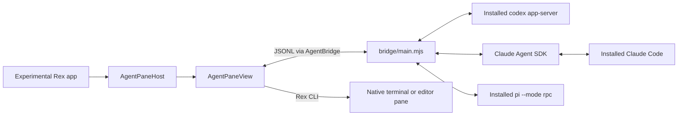

# Implementation and maintenance

This document describes the current implementation of `rex-agent-view`. Keep [README.md](README.md) focused on installation, usage, and user settings. Local design plans under `docs/plans/` are ignored and are not part of the distributed project.

## Architecture

The project supplies a Swift/AppKit view and a Node.js bridge. The installed Codex, Claude Code, and Pi harnesses still own the agent loop, tools, authentication, permissions, and transcript storage. The view renders events and sends user input and approval decisions.

There is no browser or HTML layer. This is an experimental extension loaded into a patched app copy, not an official Rex plugin or a fork of Rex source. The attachment depends on Rex's private native view hierarchy. The last tested host was Rex Beta 0.1.0, build 1758.

## Source map

| File | Responsibility |
| --- | --- |
| [native/Loader.m](native/Loader.m) | Dylib constructor, startup dispatch, diagnostic snapshot notification. |
| [native/Injection.swift](native/Injection.swift) | Visible-session discovery, view attachment, Agent menu, and ⌘⇧A action routing. |
| [rex/agent-view.lua](rex/agent-view.lua) | Guarded New Agent Pane palette action, current-pane cwd, and native backing split. |
| [scripts/install-actions.mjs](scripts/install-actions.mjs) | Idempotent palette registration in the active local Rex config, validation, and reload. |
| [native/AgentPane.swift](native/AgentPane.swift) | Conversation state, compact header, growing composer, streaming message/tool views, approvals, and export. |
| [native/AgentMarkdown.swift](native/AgentMarkdown.swift) | Foundation Markdown block parsing, paragraph/list styling, stable prose views, and native code cards. |
| [native/AgentTable.swift](native/AgentTable.swift) | Native attributed table cells, column sizing, wrapping, and horizontal overflow. |
| [native/AgentControls.swift](native/AgentControls.swift) | History picker, model/effort controls, completion popup, and conversation record types. |
| [native/AgentBridge.swift](native/AgentBridge.swift) | One Node child per pane, JSONL framing, error delivery, history timeouts, and shutdown. |
| [native/AgentTheme.swift](native/AgentTheme.swift) | Rex palette resources, imported themes, and appearance defaults. |
| [native/AgentAppearance.swift](native/AgentAppearance.swift) | Font preferences, font fallback, notifications, and the native appearance window. |
| [native/AgentLinks.swift](native/AgentLinks.swift) | Local path parsing, editor selection, and opening an adjacent Rex pane. |
| [bridge/main.mjs](bridge/main.mjs) | Provider lifecycle, request dispatch, conversation switching, combined history, and saved selection. |
| [bridge/codex.mjs](bridge/codex.mjs) | Codex app-server RPC, streaming notifications, approvals, models, skills, and history. |
| [bridge/claude.mjs](bridge/claude.mjs) | Claude SDK integration, executable selection, streaming, approvals, catalog, and history. |
| [bridge/pi.mjs](bridge/pi.mjs) | Pi `--mode rpc` integration, executable selection, streaming, extension confirm/select dialogs, status-line notices, catalog, and session-file history. |
| [bridge/events.mjs](bridge/events.mjs) | Streaming text deduplication and readable tool activity. |
| [bridge/provider-data.mjs](bridge/provider-data.mjs) | Transcript normalization, history cursors, skill validation, usage, and CLI resume commands. |
| [bridge/pane-state.mjs](bridge/pane-state.mjs) | Atomic local storage of the selected native conversation. |

## Editing messages

The pane sends `edit` with the user message's position and original text; the bridge re-reads native history and matches it with `editIndex`, then forks and activates the fork. The original session is never modified.

- Claude: user records keep their UUID as `editId`; `forkSession` copies up to the record before it. `enableFileCheckpointing` is on for every query, and `editPreview` runs a dry-run `rewindFiles` so the pane can offer to restore files first. Forked sessions have no file history of their own, so files can only be restored from the original session.
- Codex: `editId` is the turn ID; `thread/fork` with the previous turn's `lastTurnId` runs in a short-lived app-server so the pane's next process can become the fork's writer. Codex cannot restore files.
- Pi: `editId` is the user message's session entry ID; the RPC `fork` command creates a new session from the active branch before it, then the pane resumes that session. Pi cannot restore files.

## Build, launch, and native attachment

[scripts/build.sh](scripts/build.sh) compiles `Loader.m` and `native/*.swift` into `build/RexAgent.dylib`, targeting Apple silicon and macOS 15. It signs the library and runs [scripts/prepare-app.mjs](scripts/prepare-app.mjs). `--probe` builds a minimal placeholder view for attachment debugging.

The preparation script copies `/Applications/Rex Beta.app` to `build/Rex Agent View.app` when needed. It thins universal binaries to arm64, adds a weak Mach-O dylib load command in existing header padding, places the library in `Contents/Frameworks`, and signs the copy. It replaces executable/library files through fresh inodes to avoid stale mapped code signatures. The copy receives its own bundle identifier, disables its updater, and permits loading the local library. The installed app and its server are not build targets.

[scripts/launch.sh](scripts/launch.sh) installs the palette action, then finds or creates the `rex-agent` session and its `Agent Workspace` tab. The backing block runs `tail -f /dev/null` and has a `rex-agent:` label. LaunchServices opens the copied app with the integration environment; the script finds the new client and selects the workspace through the Rex CLI. The app path, `CFBundleDisplayName`, and exact client-name match in the launcher must agree when changing the visible app name.

`Loader.m` starts the module only when `REX_AGENT_ROOT` is present. `AgentPaneHost` then:

1. Caches the session ID/label directory and resolves visible native windows by the longest unique session-label suffix in their titles. Refreshes visible session layouts every 0.4 seconds, with at most one inspection per session in flight; cached hidden sessions are checked every 10 seconds to release closed blocks.
2. Finds each session’s active tab and tiled blocks, then locates visible `GhosttyTerminal.SurfaceView` instances in its matching native window. One cached view owns each block: when two native windows show the same session, prefer the key window and keep its host stable until focus changes.
3. Maps surface positions to the server's normalized layout rectangles. Zoom needs special handling because Rex retains hidden or covered terminal surfaces.
4. Reads the backing process’s cwd before constructing each `AgentPaneView`, retrying if the process is still starting. Mounts only `rex-agent:` blocks; Rex retains ownership of pane headers, splits, resizing, and closing.
5. Reuses views by block ID across tab switches and removes them when their blocks disappear.

The Agent menu is restored if SwiftUI replaces the menu. The shortcut consumes an event only for a recognized Rex session window; held-key repeats do not create extra panes. Both keyboard/menu handlers dispatch `rex_agent_new_pane`, passing the visible session with `-s` and leaving focused-block resolution to Rex. Clear inherited `REX_SESSION`/`REX_BLOCK` from these subprocesses. `-C` routes queued client actions but does not replace a server action’s caller or supply its selected session. The native helper therefore also passes `app_client_id`; the Lua action verifies that target is a connected Rex Agent View app. Palette invocation needs no arguments and uses its own `ctx.client_id`.

The Lua action receives the palette’s current session/block context, or resolves the focused block from the current session view. It checks the invoking client is Rex Agent View before creating a labeled backing split. Registration is server-configured, so the palette entry is visible in other clients but does not create panes there. Keep ⌘⇧A native to the experimental app; do not add a global Rex key binding. The installer preserves existing config around its marked loader, validates a candidate before installation, and reloads the server config without restarting it.

The action starts its backing `tail` with `shell = "none"` and `login = false`. With `login` left at its default, Rex 1758 wraps the direct command in `/usr/bin/login`, whose process metadata omits cwd and prevents the native pane from mounting.

This layout polling is separate from conversation history: history has no background polling. Private surface names, window-title matching, layout structure, palette resources, and bundle signing assumptions are the main Rex-version dependencies.

## Runtime configuration and local data

The repository and app are named `rex-agent-view` / **Rex Agent View**. Existing internal identifiers are deliberately retained:

| Setting or location | Meaning |
| --- | --- |
| `REX_AGENT_ROOT` | Checkout containing the bridge and local build output. |
| `REX_AGENT_CLI` | Installed Rex CLI executable. |
| `REX_AGENT_NODE` | Node executable for the bridge. |
| `REX_AGENT_SESSION` | Initial session selected by the launcher; native agent views also work in other visible sessions. |
| `REX_AGENT_WINDOW` | Initial workspace passed by the launcher; attachment resolves the current active tab. |
| `REX_AGENT_CLAUDE` | Highest-priority override for the Claude executable. |
| `REX_AGENT_PI` | Highest-priority override for the Pi executable. |
| `com.superlogical.rex.agent.experimental` | Experimental app's preference domain and bundle identifier. |
| `.rex-agent/config.json` | Optional local `claudeExecutable` and `piExecutable` settings. |
| `.rex-agent/panes/` | Selected provider/session, cwd, model, and effort for each pane. |
| `build/launch-context.json` | Last launch's Rex session/window IDs. |

`AgentBridge` inherits the app environment and supplements `PATH` with common executable locations. Claude executable selection is environment override, then the adapter-local config file, then PATH discovery. Shell aliases are not expanded. Claude loads user, project, and local settings, preserving provider configuration such as Bedrock and credential helpers. Neither provider adapter requests a permission bypass.

`PaneState` hashes the Rex session/block key into a JSON filename, creates its directory with mode `0700`, and writes files with mode `0600` through a temporary file and rename. It does not copy transcripts. When restoring a saved conversation fails, the bridge reports the failure and preserves the old association until a new session replaces it.

Keep app bundles, dependencies, logs, snapshots, credentials, and `.rex-agent/` out of Git. Build from the user's installed Rex; do not distribute the copied Rex app as source content.

## Bridge protocol and lifecycle

`AgentBridge` starts `node bridge/main.mjs --provider <codex|claude> --cwd <directory> --pane <key>`. Standard input and output carry one JSON object per line. Standard error is diagnostic text; keep logging off protocol stdout. Native reads are buffered until a complete line arrives and delivered on the main thread.

| UI request `type` | Purpose |
| --- | --- |
| `prompt` | Send `text` and optional skill references with the selected model/effort. |
| `new`, `resume` | Start fresh or resume `sessionId`, optionally switching provider. |
| `configure` | Set model/effort; null or empty values reset overrides. |
| `catalog` | Read available models, effort levels, and skills. |
| `sessions` | List combined history using `requestId`, scope, cursor, and optional repair mode. |
| `approval` | Answer a provider request with `accept` or `decline`. |
| `stop`, `close` | Interrupt the active turn or close the bridge/provider. |

Events include `conversation`, `session`, `ready`, `catalog`, `configured`, `sessions`, `delta`, `activity`, `approval`, `status`, `usage`, `done`, and `error`. Native transport failures additionally produce `disconnected`. Errors retain the originating operation and request ID when available.

The coordinator guards new prompts, configuration, and conversation switching while busy. Switching prepares the candidate provider and transcript before replacing the previous provider. A same-provider, same-session resume returns ready without opening another writer. Late events from a superseded provider are ignored, and history results are rejected if the conversation changed while loading.

Each pending history request has a native 30-second timeout; completion, replacement, failure, or shutdown cancels its timer. Broken writes use `F_SETNOSIGPIPE` so an exited bridge cannot terminate Rex with SIGPIPE. Closing the native bridge first requests orderly shutdown, then terminates the process after two seconds if necessary.

## Provider history and agent behavior

Codex runs the installed `codex app-server` with experimental API capability enabled. The adapter manages request IDs and notifications, reads model/skill catalogs, resumes threads, submits turns, and maps approval and interruption events into the shared protocol. Thread start and resume explicitly use `approvalPolicy: on-request`, `approvalsReviewer: user`, and the `workspace-write` sandbox. Claude uses the pinned `@anthropic-ai/claude-agent-sdk` dependency with the selected installed Claude Code executable and `permissionMode: default`. Both adapters ask agents to use ordinary chat for clarification because the UI has no structured question dialog.

The history coordinator creates separate read-only provider instances, queries both providers, merges rows by update time, and closes the temporary instances. A failure in one provider is returned as a warning alongside the other provider's results.

For Codex, normal `thread/list` requests use `useStateDbOnly: true`. This avoids the rollout-file scan and index repair that made History slow. **Find older sessions** explicitly sets repair mode, which uses the slower scan. Combined pagination cursors retain provider cursors, project/all scope, cwd, and source (`native-index` or `native-repair`); recovery pagination must stay in repair mode. An ordinary refresh returns to the fast path. Claude lists sessions through its SDK; it does not use Codex's index/repair option. No extra transcript cache is maintained.

Resume loads the native transcript and original cwd before a new turn. Keep text and tool activity in their original order when normalizing history; tool results belong to their originating activity, not to a new user message. Session sharing means sequential continuation in the UI or CLI, not concurrent live attachment or cross-device synchronization.

Claude history normalizes complete user-side `command-name`, `command-message`, `command-args`, and `local-command-stdout` wrapper sequences into `role: "command"` records with `{name, args, output}` under `command`. Adjacent stdout records join the command; standalone output remains its own card. Quoted examples, incomplete/unknown markup, and assistant text stay ordinary content. `text` contains a readable invocation/output for Markdown export; the original session files are never rewritten. Native `AgentCommandView` uses the code font for the invocation and proportional Markdown for output, and follows font/theme changes.

Model and effort controls come from provider catalogs. Explicit defaults must clear previous overrides. Codex skill references are checked against the current catalog; Claude skill commands are composed at the beginning of the prompt. Text streaming must deduplicate partial output against authoritative final messages.

## Native rendering and interaction

`AgentPaneView` owns the composer and transcript records. A response can contain several message segments: when prose follows a tool or approval, it starts a new segment. Stable activity IDs map later updates back to the original tool view and transcript record. Do not gather completed commands into a list at the end of a response.

`AgentMarkdownView` uses Foundation Markdown presentation intents to group paragraphs, headings, nested lists, quotes, and fenced code. Source blank lines become paragraph spacing rather than empty text lines. Assistant soft breaks flow as prose; user soft breaks remain visible. Prose and code views are reused by block position/type during streaming. `GrowingTextView` uses NSTextStorage/NSLayoutManager, skips identical attributed content, preserves valid selection ranges, and invalidates its intrinsic height when content or width changes. File-link clicks remain routed through `AgentLinks`.

Each code card has a language label, Copy feedback, and a nonwrapping native text view in a horizontal scroll view. Copy retains the exact code content without fences. List markers and indentation stay attached to code when it starts a list item. Markdown table presentation intents produce attributed cells and column alignments for `AgentTableView`, which lays out selectable native text views with a tinted header and row/column rules. Columns wrap to available width and scroll horizontally when their minimum widths exceed the pane. Links and inline formatting use the same attributes as prose. Selection is native within each prose/code block or table cell; a single selection does not span separate views.

The transcript column targets about 74 characters, measured using the chosen prose font, and adapts to narrow panes. The composer grows from two lines to a bounded scrollable area; its provider/model/effort and status/action groups stack at narrow widths. Programmatic text changes, completions, and font changes recalculate height and Send eligibility. Focus changes tint the composer border. The header derives its title from the first user prompt and shows the project basename with the full cwd in a tooltip.

Capture follow-bottom state before adding tool/text segments or approvals. Streaming and composer growth must preserve the reading position when the user has scrolled back. Resolved model labels are display-only: default popup items retain a nil represented value, and opening a menu exposes “Use agent default.” Unknown inherited effort must not be guessed.

Inline code uses a custom attributed-string key and `AgentTextLayoutManager.drawBackground`. The highlight height follows the code font's ascender/descender around the actual glyph baseline, separately for wrapped lines. AppKit's ordinary `.backgroundColor` would fill the taller prose line, especially in headings. Native selection is drawn afterward so it remains visible above the code tint. Fenced code uses the card surface instead of per-line background attributes.

`AgentTheme` reads Rex's bundled palettes, imported theme data, and the experimental app's preferences. `AgentAppearance` stores separate text/code families and sizes under `RexAgent.Appearance.Fonts`; valid sizes are 8–48 points. Defaults are system text at 15 points and system monospace at 12.5 points. Missing families fall back to system fonts. Change notifications re-render existing messages and update the composer while preserving scroll position unless already at the bottom. Appearance uses a separate native window because Rex exposes no Settings-sidebar registration hook.

Local links resolve against the conversation cwd and support file URLs, `:line:column`, and `#Lline` forms. `AgentLinks` reads `$EDITOR` with a fixed command in an interactive login shell, falling back to `nvim`. It parses editor words without shell expansion and passes the editor command, options, and path as separate Rex CLI arguments. Never interpolate response paths into executable shell text. HTTP(S) links retain ordinary browser handling.

## Verification and diagnostics

Run checks appropriate to the change from the checkout root:

| Command | Coverage |
| --- | --- |
| `npm test` | Provider events, lifecycle, persistence, history normalization/cursors, model defaults, skills, and failures. |
| `./scripts/check-shortcut.sh` | Synthetic shortcuts across sessions, current-client action routing, deleted initial workspace, menu replacement, and Appearance availability. |
| `./scripts/check-attachment.sh` | Native attachment in another session, cwd retry, stable ownership across windows, and slower hidden-session cleanup. |
| `node --test scripts/install-actions.test.mjs` | Managed palette registration, config preservation/rollback, action context, app guard, and cwd selection; uses temporary files and a read-only Rex Lua fixture. |
| `./scripts/check-conversation.sh` | Chronological streaming, reading/selection preservation, links, Markdown lists/spacing, rich table cells, local-command cards, code Copy/scrolling, live fonts, and inline-code geometry. |
| `./scripts/check-table.sh` | Table row/column geometry, narrow wrapping, horizontal overflow, selection reuse, links, font changes, and themes. |
| `./scripts/check-layout.sh` | Growing composer, programmatic input, synthetic Return/Shift+Return and completion selection, header context, and dark/light layouts at 340/700/1100 points. |
| `./scripts/check-models.sh` | Resolved labels, nil default semantics, effort resets, and persisted selections outside the catalog. |
| `./scripts/check-links.sh` | Path parsing and editor/Rex argument handling. |
| `./scripts/check-history.sh` | Transport failure/timeout, native history selection, resume, retry, and empty state. |
| `./scripts/check-appearance.sh` | Preference persistence, font fallback/traits, controls, preview, reset, and size bounds. |
| `./scripts/build.sh` | Native compilation and preparation/signature verification of the experimental app. |

The checks use fixtures or fake transports and do not require live model turns or existing local conversations. Native shortcut tests post synthetic AppKit events and do not establish that physical OS keyboard input was automated.

With the experimental app running, `notifyutil -p dev.rexagent.snapshot` requests native snapshots. Inspect `build/native.log`, `build/views.txt`, `build/native-pane.png`, and `build/native-workspace.png`. These files can contain conversation text and must stay local. AppKit snapshots may omit terminal Metal rendering, and an offscreen view captured without its window background may appear transparent. Use actual native snapshots to assess visual fixes.

For full-pane layout previews, run `REX_AGENT_LAYOUT_PREVIEW_DIR=/tmp/rex-layout ./scripts/check-layout.sh`. For a focused text preview, run `REX_AGENT_CONVERSATION_PREVIEW=/tmp/rex-inline-code.png ./scripts/check-conversation.sh`. For command/table previews at narrow and regular widths in both appearances, use `REX_AGENT_RICH_PREVIEW_DIR=/tmp/rex-rich ./scripts/check-conversation.sh`. For attachment-only debugging, use `./scripts/build.sh --probe` and rebuild normally afterward.

Before reloading, finish or stop active agent turns, quit only the experimental app, build, and launch through the script. Do not restart the shared Rex server or the installed Rex app as part of a UI rebuild. A change to app naming must update both preparation and launch code; a change to pane/session identifiers or preference keys requires a migration decision.

The native-loading approach was informed by the MIT-licensed [rexmod](https://github.com/alpcanaydin/rexmod) project. Its installer is not used.
