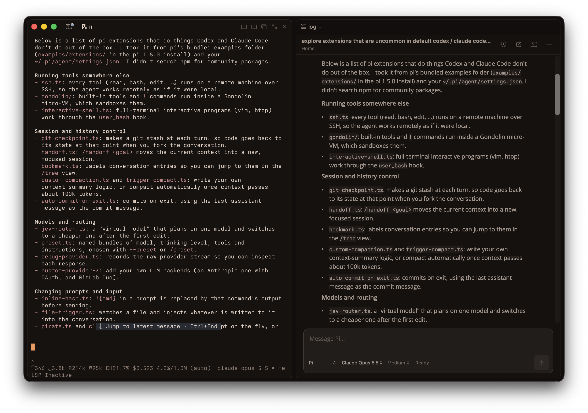

# rex-agent-view

Native Claude Code, Codex, and Pi conversations inside Rex, next to real terminal panes.



*A terminal (left) beside an agent conversation pane (right) in the same Rex tab.*

Experimental macOS add-on. It builds a separate **Rex Agent View** app and leaves your Rex install untouched. Tested with Rex Beta 0.1.0 (build 1758).

## Install

Requires Apple silicon, macOS 15+, Rex Beta at `/Applications/Rex Beta.app`, Xcode command-line tools, Node.js 22+, and a signed-in `claude`, `codex`, or `pi` CLI.

```sh
git clone https://github.com/rooa/rex-agent-view.git
cd rex-agent-view
npm ci
./scripts/build.sh
./scripts/launch.sh
```

Always start the app with `./scripts/launch.sh`. Quit it before rebuilding.

## Use

- **New pane:** **⌘⇧A**, **Agent → New Agent Pane**, or **⌘⇧P → New Agent Pane**. It opens beside the focused terminal, in that terminal's directory.
- **Chat:** pick an agent, type, and press **Return** (**Shift+Return** for a new line). **Stop** interrupts a turn; tool requests show **Allow**/**Deny**.
- **Completion:** **`/`** for commands and skills, **`$`** for Codex skills, **`@`** for file paths. **`/help`** lists pane commands.
- **Edit:** hover your message and click the pencil, or press **↑** in an empty box for the last one. Sending forks the conversation from there; the original stays in History. For Claude you can also restore the files it changed since.
- **Images:** paste with **⌃V** or **⌘V**; click an attached image to remove it.
- **Model and effort:** set them in the message box, or choose **Use agent default**.
- **History:** browse and resume saved local sessions; a resumed conversation reopens in its original directory. Each pane remembers its conversation across restarts.
- **Share:** the **…** menu exports Markdown or copies a CLI resume command.
- **Terminal:** opens a Rex shell beside the chat. File links open in `$EDITOR` (default `nvim`).
- **Appearance:** **Agent → Appearance…** sets the fonts. Colors follow your Rex theme.

## Configure

The pane uses each CLI's own settings. To pick a specific executable, add `.rex-agent/config.json`:

```json
{"claudeExecutable": "/opt/homebrew/bin/claude", "piExecutable": "/path/to/pi"}
```

Or set `REX_AGENT_CLAUDE` / `REX_AGENT_PI` when launching. A change applies to new conversations.

Pi runs in `--mode rpc` with your extensions. Extension confirmations and choice lists appear inline, and their notices show in the status line. Text-input dialogs are declined.

## Limits

- Only Rex Agent View shows agent panes. The palette entry also appears in Rex Beta but does nothing there.
- History is local only. Don't use the same conversation in the UI and the CLI at once.
- Unsent drafts are lost when the pane closes.
- No attachments, review workflows, or question forms; agents ask questions in chat.
